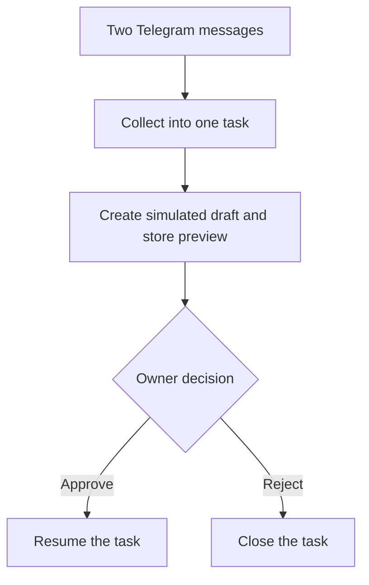

# Telegram Task Room

**A portfolio preview of AI Team (1+4).** Turn follow-up messages into a single task, review a draft, and approve or reject that exact draft. The task and its pending approval survive a restart.

```sh
npm run demo
npm test
```

Requires Node.js 20.3 or later. The default demo runs offline, needs no credentials and uses a fictional library workshop. It prints the combined brief, four specialist role outputs, the pending preview and the result after reopening the saved task. Outputs are deterministic fixtures.



## Optional Telegram demo

1. Copy `.env.example` to `.env` and enter credentials for your own test bot, the owner's numeric Telegram user ID and a dedicated private group's numeric chat ID.
2. Run `node --env-file=.env telegram.mjs` using Node.js 20.6 or later, and keep the process running.
3. Within 12 seconds, send `/demo Plan a fictional library workshop` and `/demo Add an attendee reminder`. Wait for the preview, then choose **Approve and resume** or **Reject**.

This preview accepts only `/demo` messages and approval callbacks from the configured owner and group. Run one process per bot/state file. Text is sent to Telegram in the optional live demo and retained locally in `data/state.json`. Use invented tasks. The offline demo creates temporary state and removes it when it exits.

## Project history and scope

- **v0.1.0** introduced the five-role, local Codex chat prototype in [AI Team Room](https://github.com/MauriceChang1027/ai-team-room).
- **Private v0.50.0** evolved into a Telegram workflow with specialist routing, persistent tasks and human approval.
- **v0.50.0-preview** is a standalone showcase of the task and approval loop using simulated role responses. It reuses the local atomic store. Company data, production connectors, account configuration and private Git history are outside this preview. The optional Telegram transport is a single test bot.

Copyright © 2026 MauriceChang1027. All rights reserved. See [LICENSE](LICENSE).
